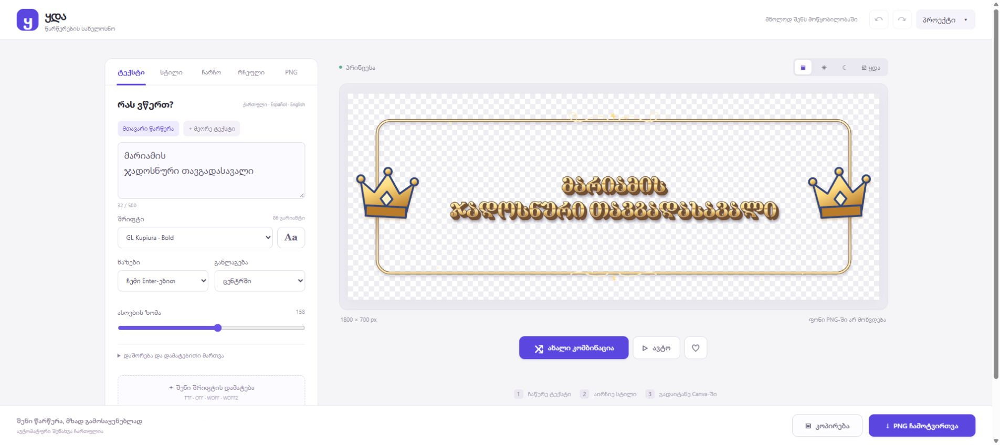

# Release verification — 2026-10-29

Application commit: `c31ddffedaeda953e96ac46ca111628af3e14130`.

- Nine Node tests passed locally and in GitHub Actions (run 40868150805).
- Browser integration checks passed with all 86 fonts loaded. Every font renders different pixels for Georgian ღ and ლ.
- Fixed 1/2/3 lines, manual line breaks, long Georgian text and Georgian/Spanish blocks fit the available text area.
- All 30 themed frame illustrations and all 25 materials produce distinct rendered images.
- PNG decoding verified transparent corners, nonempty pixels and exact crop padding for combined, text-only and frame-only exports.
- The empty-layer export is rejected with a visible message.
- Mobile iframe layouts checked at 320 and 390 px; the live HTTPS site also checked at a 390 × 844 viewport. No horizontal overflow was observed. Desktop layout was visually inspected.
- Manual UI checks covered bilingual editing, a legacy font, combination locks, favorites, automatic saving and restoring after a reload.
- GitHub Pages deployment run 40868230119 succeeded. The public site was opened successfully at https://mamuluxgeo-cmd.github.io/yda/.
- On the live site, the PNG button completed and reported a transparent 3614 × 1268 image. The clipboard write resolved and the application displayed its success message. Browser automation's download-event capture was unavailable; Canva paste and physical iOS/Android devices were not exercised.

The screenshot is from the deployed application, with the default example title and no private cover image.

## Opaque frame interiors

The frame now has an opaque white interior by default, including projects saved before this setting existed. Its fill color can be changed in the Frame tab, restored to white, or set to the current palette's theme color. Canvas outside the frame remains transparent; text-only exports and hidden frames omit the fill.

All 10 Node tests passed. Browser checks also passed for all five frame shapes: selected RGB color and alpha 255 at the interior, alpha 0 outside, matching preview and decoded PNG pixels. Existing font, layout, material, theme and export checks remained green.

## Themed frame backgrounds

Six illustrated background styles (cosmic, royal, forest, pearl, football and racing), plus gradient and solid, now use the same Canvas renderer for the preview, thumbnails and PNG. All 30 themes select a suitable background automatically. Two colors, ornament intensity, three palette variants per illustrated style and an independent seed are persisted in project state. A background-only shuffle preserves title and frame settings; the background lock is respected by combination shuffle, theme changes and presets.

- All 15 Node tests passed, including old-project migration, import sanitization, project serialization, all-theme mappings, background-only mutation boundaries and theme locking.
- Full browser rendering checks passed: all 86 fonts, text layout, 30 frame themes, 25 materials, alpha crop, plus every one of 8 background styles in all 5 shapes. Decoded PNG colors match the preview; interiors are opaque and exterior corners transparent.
- Repeated renders preserve ornament positions. Zero intensity removes ornaments; both custom colors affect the image. Text-only exports and hidden frames omit backgrounds.
- UI checks covered theme selection, background-only shuffle, two custom colors, undo/redo, background locking during a general shuffle, and persistence after reload.
- The new controls were exercised at 320 and 390 px iframe widths, with no horizontal overflow. The theme thumbnail grid can be expanded on demand to keep background controls easy to reach.

Canva paste and physical mobile devices were not retested for this change.
